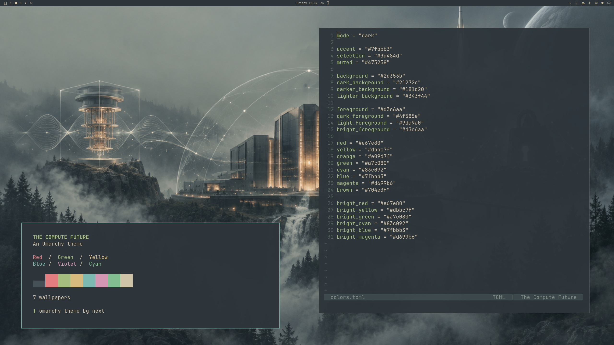

# The Compute Future

An Everforest-based Omarchy theme with dark forest colors, warm cream text, and
seven science-fiction wallpapers: spacecraft, misty forests, and gold-lit
computing structures. The palette is unchanged from stock Everforest.



## Install

```bash
omarchy theme install https://github.com/TheComputeCenter/omarchy-the-compute-future-theme
```

The installed theme name is `the-compute-future`. Cycle wallpapers with
`omarchy theme bg next`. If you already have a working copy with that name,
back it up first: the installer replaces the existing theme directory.

## Contents

- `colors.toml`: stock Omarchy Everforest palette.
- `icons.theme`: Yaru-sage icons.
- `backgrounds/1.png` through `7.png`: seven wallpapers; see [WALLPAPERS.md](WALLPAPERS.md).
- `neovim.lua` and `vscode.json`: stock Everforest settings for local use.
- `preview.png`: real 2560×1440 desktop capture using wallpaper `3.png`.

On tested Omarchy 4.0.4-1, Git-installed themes regenerate terminal and editor
configurations from `colors.toml`; bundled `neovim.lua` and `vscode.json` are
not used. The preview shows the local Everforest editor override. Git-installed
editors can differ in syntax details while using the same base palette.

## Validation

Seven wallpapers decode successfully. Palette foreground/background contrast
is 7.38:1. All 19 installed stock app templates generate with valid TOML/JSON
and no unresolved tokens. The real desktop preview has a 16:9 aspect ratio.
These checks do not constitute a live end-to-end theme installation test.

## License and credits

Released under the [MIT License](LICENSE), including the supplied wallpapers
and project documentation, following the project owner's open-license direction.
The palette and app settings come from [Omarchy's Everforest theme](https://github.com/omacom/omarchy/tree/master/themes/everforest).
See [CREDITS.md](CREDITS.md) and the preserved notice in `LICENSES/Omarchy-MIT.txt`.
The repository is the theme source; a gallery listing requires a separate upstream PR.
